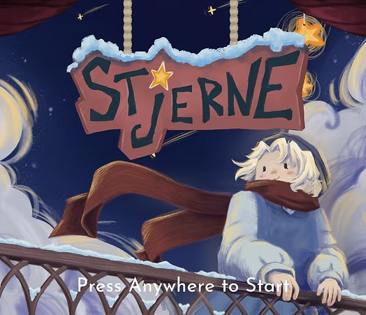
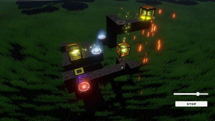
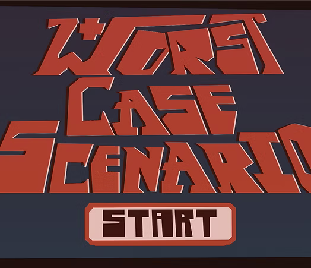
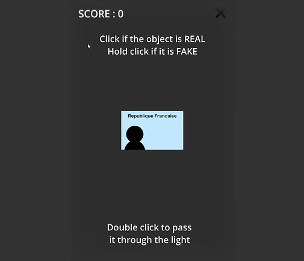
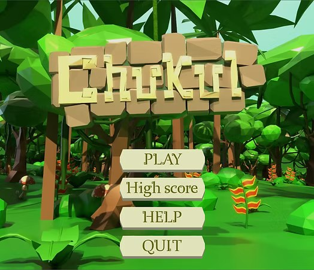
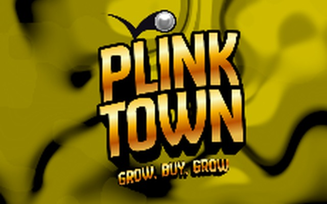
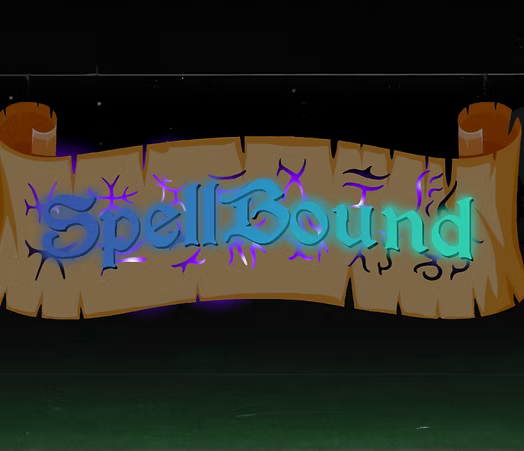
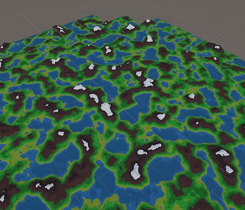

  

<h1 align="center">Dorian Simon</h1>

  <b>Game Designer &amp; Game Programmer</b> 
  Étudiant en Mastère Game Design &amp; Programmation à l'ISART Digital Paris 
  <i>Ouvert aux stages</i>

  <a href="https://aiko973.github.io/">Portfolio</a> ·
  <a href="https://dorianaiko.itch.io/">itch.io</a> ·
  <a href="https://www.linkedin.com/in/dorian-simon-5a45a7386/">LinkedIn</a> ·
  <a href="mailto:dorian270706@gmail.com">dorian270706@gmail.com</a>

## À propos de moi

C'est mon grand frère qui m'a fait découvrir le jeu vidéo, et depuis, je n'ai
jamais arrêté de vouloir faire les miens. Je suis aujourd'hui en Mastère Game
Design & Programmation à l'ISART Digital Paris, que j'ai rejoint en 2025.

Ce qui me plaît le plus, c'est le moment où une règle simple devient un
système : une grille qu'on lit d'un coup d'œil, une économie qui tient
debout, un boss dont les attaques tombent pile sur la musique.

Je code surtout en C# sous Unity et Godot, je modélise et j'assemble mes
assets sur Blender, et je passe au Python, au SQL ou au JSON quand un projet a
besoin de données propres. J'ai travaillé seul comme en équipe, jusqu'à
treize personnes sur Stjerne. Dans un groupe, j'aime particulièrement le
moment où l'on se met d'accord sur ce que le jeu doit faire comprendre, avant
d'écrire la première ligne de code.

Sérieux et autonome, je cherche une équipe où apporter ce que je sais faire,
et apprendre ce que je ne sais pas encore.

## Mes projets

<table>
  <tr>
    <td width="260"></td>
    <td><b><a href="https://aiko973.github.io/projet.html?id=stjerne">Stjerne</a></b> Un jeu de plateforme inspiré de La Petite Fille aux allumettes, réalisé à 13 avec un comédien de doublage professionnel. Janvier 2025 · Unity (C#) · 13 personnes · <a href="https://youtu.be/gkLrri_e56g">Vidéo</a></td>
  </tr>
  <tr>
    <td width="260"></td>
    <td><b><a href="https://aiko973.github.io/projet.html?id=rush">Rush</a></b> Un jeu de puzzle où l'on dispose flèches et convoyeurs pour amener des cubes jusqu'à leur objectif. Novembre 2025 · Unity (C#) · Seul · <a href="https://youtu.be/sXp_q8HIOp8">Vidéo</a></td>
  </tr>
  <tr>
    <td width="260"></td>
    <td><b><a href="https://aiko973.github.io/projet.html?id=worst-case-scenario">Worst Case Scenario</a></b> Un jeu narratif situé dans les années 2100, conçu et prototypé en trois jours pour un brief de la Croix-Rouge. Juin 2025 · Godot (C#) · 4 personnes · <a href="https://youtu.be/HLIaeN8ytAw">Vidéo</a></td>
  </tr>
  <tr>
    <td width="260"></td>
    <td><b><a href="https://aiko973.github.io/projet.html?id=recognize-the-fake">Recognize the Fake</a></b> Un serious game à un seul input, décider si le document posé devant soi est vrai ou falsifié. Mai 2025 · Godot (C#) · Seul · <a href="https://youtu.be/7RbexfzZLCY">Vidéo</a></td>
  </tr>
  <tr>
    <td width="260"></td>
    <td><b><a href="https://aiko973.github.io/projet.html?id=chukul">Chukul</a></b> Un sokoban dans une pyramide maya : cinq niveaux, quatre personnes, deux mois. Avril 2025 · Godot (C#), JSON · 4 personnes · <a href="https://youtu.be/gwQ5GuEsOn0">Vidéo</a></td>
  </tr>
  <tr>
    <td width="260"></td>
    <td><b><a href="https://aiko973.github.io/projet.html?id=plink-town">Plink Town</a></b> Un jeu de plinko terminé : on place des obstacles que les billes doivent toucher, on encaisse, on rachète des obstacles. Avril 2026 · Unity 2D (C#) · 9 personnes · <a href="https://youtu.be/F6E6IsuBlXA">Vidéo</a></td>
  </tr>
  <tr>
    <td width="260"></td>
    <td><b><a href="https://aiko973.github.io/projet.html?id=spellbound">SpellBound</a></b> Un shoot 'em up réalisé comme premier projet, avec des attaques de boss calées sur la bande-son. Janvier 2025 · Godot (C#) · Seul · <a href="https://youtu.be/Lt5GHVLK8eQ">Vidéo</a></td>
  </tr>
  <tr>
    <td width="260"></td>
    <td><b><a href="https://aiko973.github.io/projet.html?id=procedural-generation">Procedural Generation</a></b> Un générateur de monde procédural, et une première approche du tool coding : paramètres exposés et optimisation. 2026 · Unity (C#) · Seul</td>
  </tr>
</table>

Toutes les fiches détaillées, avec ma contribution sur chaque projet et les
walkthroughs vidéo, sont sur le [portfolio](https://aiko973.github.io/). Les builds jouables
sont sur [itch.io](https://dorianaiko.itch.io/).

## Compétences

| | |
| --- | --- |
| **Programmation** | C#, Python, SQL, JSON |
| **Moteurs et logiciels** | Unity, Godot, Blender, Git, Photoshop, Premiere Pro, OBS |
| **Langues** | Français (langue maternelle), anglais (B2), espagnol (A2) |
| **Soft skills** | Travail en équipe, gestion du temps, leadership, relationnel, adaptabilité |

## Parcours

| | |
| --- | --- |
| **2025-2029** | **Mastère Game Design & Programming**, ISART Digital, Paris |
| **2024** | **Baccalauréat général**, lycée Anna de Noailles, Évian-les-Bains Spécialités : anglais monde contemporain, mathématiques, numérique et sciences informatiques |

## En dehors des jeux

Volley-ball, voyages et jeux de rôle.

## Me contacter

- **Email** : [dorian270706@gmail.com](mailto:dorian270706@gmail.com), le plus rapide
- **itch.io** : [dorianaiko.itch.io](https://dorianaiko.itch.io/), mes builds jouables
- **LinkedIn** : [Dorian Simon](https://www.linkedin.com/in/dorian-simon-5a45a7386/)
- **GitHub** : [Aiko973](https://github.com/Aiko973), mon code

<b>English version</b>

### About me

My older brother got me into video games, and I've wanted to make my own ever
since. I'm now a Game Design & Programming student at ISART Digital Paris,
which I joined in 2025.

What I enjoy most is the moment a simple rule turns into a system: a grid you
can read at a glance, an economy that holds together, a boss whose attacks
land right on the beat.

I mostly work in C# with Unity and Godot, model and assemble assets in
Blender, and reach for Python, SQL or JSON when a project needs clean data
behind it. I've worked solo and in teams of up to thirteen people (Stjerne).
In a team, my favourite part is agreeing on what the game should teach the
player before anyone writes a line of code.

Serious and autonomous, I'm looking for an internship where I can be useful
and keep learning.

### Projects

<table>
  <tr>
    <td width="260"></td>
    <td><b><a href="https://aiko973.github.io/projet.html?id=stjerne&amp;lang=en">Stjerne</a></b> A platformer inspired by The Little Match Girl, made with a 13-person team and a professional voice actor. January 2025 · Unity (C#) · 13 people · <a href="https://youtu.be/gkLrri_e56g">Video</a></td>
  </tr>
  <tr>
    <td width="260"></td>
    <td><b><a href="https://aiko973.github.io/projet.html?id=rush&amp;lang=en">Rush</a></b> A puzzle game about laying out arrows and conveyor belts to route cubes to their goals. November 2025 · Unity (C#) · Solo · <a href="https://youtu.be/sXp_q8HIOp8">Video</a></td>
  </tr>
  <tr>
    <td width="260"></td>
    <td><b><a href="https://aiko973.github.io/projet.html?id=worst-case-scenario&amp;lang=en">Worst Case Scenario</a></b> A narrative game set in the 2100s, designed and prototyped in three days for a Red Cross brief. June 2025 · Godot (C#) · 4 people · <a href="https://youtu.be/HLIaeN8ytAw">Video</a></td>
  </tr>
  <tr>
    <td width="260"></td>
    <td><b><a href="https://aiko973.github.io/projet.html?id=recognize-the-fake&amp;lang=en">Recognize the Fake</a></b> A one-button serious game: decide whether the document in front of you is real or forged. May 2025 · Godot (C#) · Solo · <a href="https://youtu.be/7RbexfzZLCY">Video</a></td>
  </tr>
  <tr>
    <td width="260"></td>
    <td><b><a href="https://aiko973.github.io/projet.html?id=chukul&amp;lang=en">Chukul</a></b> A sokoban set inside a Mayan pyramid: five levels, four people, two months. April 2025 · Godot (C#), JSON · 4 people · <a href="https://youtu.be/gwQ5GuEsOn0">Video</a></td>
  </tr>
  <tr>
    <td width="260"></td>
    <td><b><a href="https://aiko973.github.io/projet.html?id=plink-town&amp;lang=en">Plink Town</a></b> A finished plinko game: place obstacles the balls have to hit, cash in, buy more obstacles. April 2026 · Unity 2D (C#) · 9 people · <a href="https://youtu.be/F6E6IsuBlXA">Video</a></td>
  </tr>
  <tr>
    <td width="260"></td>
    <td><b><a href="https://aiko973.github.io/projet.html?id=spellbound&amp;lang=en">SpellBound</a></b> A shoot 'em up built as a first project, with boss attacks timed to the soundtrack. January 2025 · Godot (C#) · Solo · <a href="https://youtu.be/Lt5GHVLK8eQ">Video</a></td>
  </tr>
  <tr>
    <td width="260"></td>
    <td><b><a href="https://aiko973.github.io/projet.html?id=procedural-generation&amp;lang=en">Procedural Generation</a></b> A procedural world generator, and a first pass at tool coding: exposed parameters and optimisation. 2026 · Unity (C#) · Solo</td>
  </tr>
</table>

### Skills

- **Programming**: C#, Python, SQL, JSON
- **Engines and software**: Unity, Godot, Blender, Git, Photoshop, Premiere Pro, OBS
- **Languages**: French (native), English (B2), Spanish (A2)
- **Soft skills**: teamwork, time management, leadership, people skills, adaptability

### Education

- **2025-2029**: Master's degree in Game Design & Programming, ISART Digital, Paris
- **2024**: General baccalaureate, Lycée Anna de Noailles, Évian-les-Bains

### Contact

[dorian270706@gmail.com](mailto:dorian270706@gmail.com) ·
[itch.io](https://dorianaiko.itch.io/) ·
[LinkedIn](https://www.linkedin.com/in/dorian-simon-5a45a7386/) ·
[Portfolio](https://aiko973.github.io/?lang=en)

---

Ce dépôt contient aussi le code du portfolio, en ligne sur
[aiko973.github.io](https://aiko973.github.io/). Pour le modifier, voir [GUIDE.md](GUIDE.md).
